# EdgeEver 场景与实操指南

整理 EdgeEver 在日常工作、学习和知识管理中的核心使用场景与操作工作流。

## 目录

### 核心工作区与沉浸创作
- [1. 经典三栏工作区与沉浸排版写作](#1-经典三栏工作区与沉浸排版写作)

### 全渠道内容采集与剪藏
- [2. 微信聊天记录归档与整理](#2-微信聊天记录归档与整理)
- [3. 手机端剪藏微信公众号文章](#3-手机端剪藏微信公众号文章)
- [4. 移动端图片分享转存笔记](#4-移动端图片分享转存笔记)
- [5. 小红书图文笔记剪藏](#5-小红书图文笔记剪藏)
- [6. X (Twitter) 推文与引用剪藏](#6-x-twitter-推文与引用剪藏)
- [7. 知乎回答与文章剪藏](#7-知乎回答与文章剪藏)
- [8. Reddit 讨论帖剪藏](#8-reddit-讨论帖剪藏)
- [9. GitHub 仓库元数据剪藏](#9-github-仓库元数据剪藏)

### AI 增强与多维数据组织
- [10. AI 对话生成思维导图、流程图与架构图](#10-ai-对话生成思维导图流程图与架构图)
- [11. AI 生成结构化信息图（时间线、对比矩阵、象限图等）](#11-ai-生成结构化信息图时间线对比矩阵象限图等)
- [12. AI 对话构建多维表格](#12-ai-对话构建多维表格)
- [13. 多维表格生成公开收集表单](#13-多维表格生成公开收集表单)
- [14. 连接本机 Agent (ACP) 实现笔记协同](#14-连接本机-agent-acp-实现笔记协同)

### 排版与多渠道分发
- [15. AI RSS 订阅日报与长图分享](#15-ai-rss-订阅日报与长图分享)
- [16. 笔记制作社交媒体海报与封面](#16-笔记制作社交媒体海报与封面)
- [17. 复制笔记至微信公众号排版](#17-复制笔记至微信公众号排版)

---

## 核心工作区与沉浸创作

### 1. 经典三栏工作区与沉浸排版写作

EdgeEver 采用「目录树 · 笔记列表 · 编辑区」三栏布局：

- **灵活布局**：侧边栏支持按需拖拽调整宽度或一键折叠，随时切换到全屏专注写作状态。
- **混合编辑**：右侧主编辑区支持所见即所得（WYSIWYG）富文本与原生 Markdown 语法混写。

| 三栏工作区布局（目录树 · 笔记列表 · 编辑区） |
:---:
|  |

---

## 全渠道内容采集与剪藏

### 2. 微信聊天记录归档与整理

在微信中多选对话并点击「合并转发」，在「转发到其他应用」中选择 **EdgeEver**，即可将聊天记录转换为结构化笔记。

- **格式解析**：自动解析发言人、时间轴、微信表情与超链接。
- **资源转存**：图片自动内嵌展示，文档与音视频（如 `.xlsx`、`.pdf`、`.mp4`）自动转为笔记附件并支持全文检索。

| 1. 微信合并转发至 EdgeEver | 2. 结构化笔记预览 |
| :---: | :---: |
| 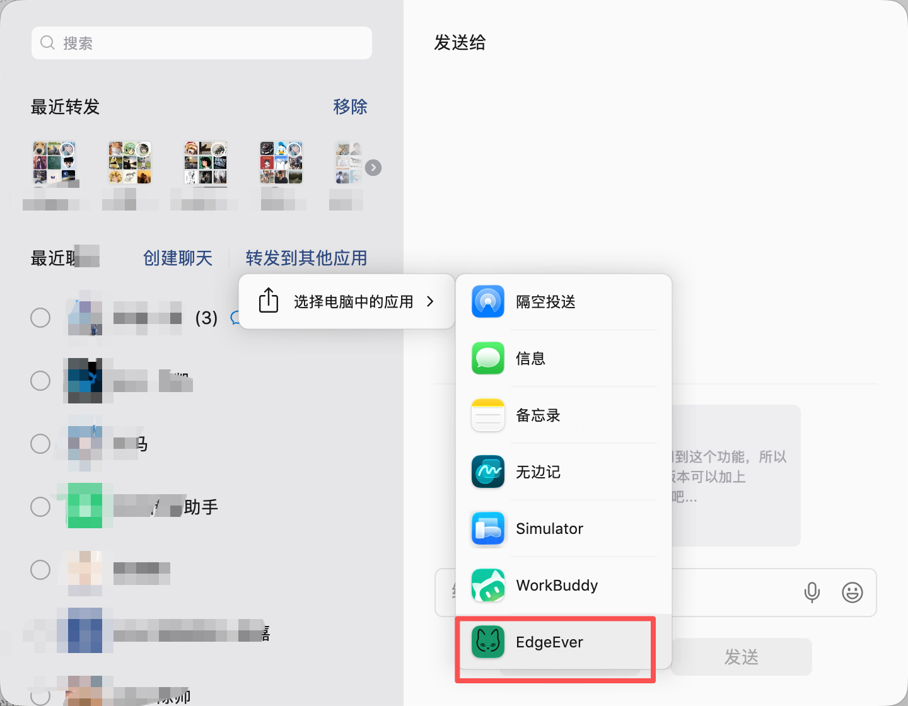 |  |

---

### 3. 手机端剪藏微信公众号文章

在手机微信中阅读公众号文章时，点击右上角菜单选择「用 EdgeEver 打开」即可完成全文剪藏。

- 自动提取标题、正文结构与配图链接，过滤页面冗余元素，转换为 Markdown 笔记。

| 1. 选择「用 EdgeEver 打开」 | 2. 内容提取中 | 3. 剪藏生成的 Markdown 笔记 |
| :---: | :---: | :---: |
| 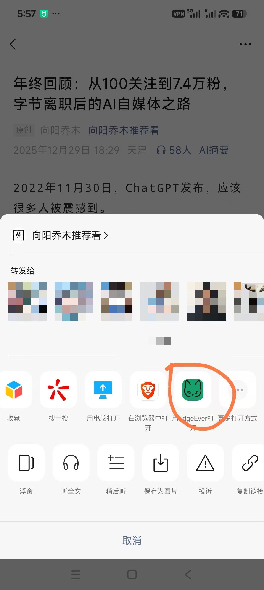 | 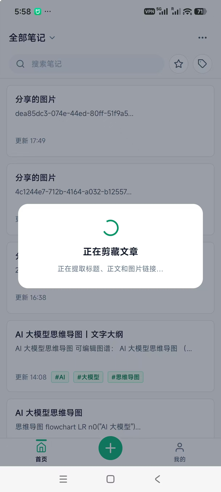 |  |

---

### 4. 移动端图片分享转存笔记

在手机浏览各大社交与资讯应用（如 X / Twitter、Reddit、Instagram、Pixiv、知乎、微博等）时，通过系统分享功能直接保存图片。

- 在系统分享面板选择 **EdgeEver**，应用在后台上传原图并创建以「分享的图片」为标题的独立笔记。
- 便于后续追加文字批注或整理。

| 1. 分享图片 | 2. 选择 EdgeEver | 3. 生成图片笔记 |
| :---: | :---: | :---: |
| 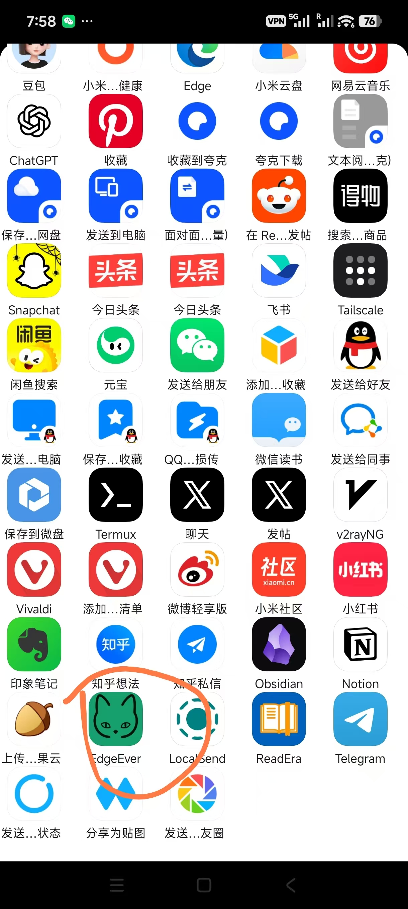 | 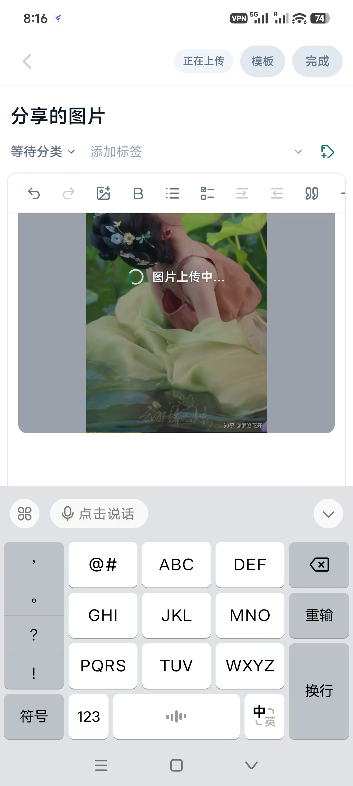 |  |

---

### 5. 小红书图文笔记剪藏

在浏览器访问小红书网页版时，使用 EdgeEver Web Clipper 插件在笔记页面右键点击「保存笔记到 EdgeEver」。

- 完整提取标题、话题标签、正文、发布时间、地点与原文链接。
- 多图内容自动排版为多栏画廊。

| 1. 右键菜单剪藏 | 2. 多栏画廊笔记效果 |
| :---: | :---: |
|  |  |

---

### 6. X (Twitter) 推文与引用剪藏

浏览 X (Twitter) 时，使用 EdgeEver Web Clipper 插件在推文上右键点击「保存推文到 EdgeEver」。

- 提取作者信息、推文正文、外链、引用推文（Quote Tweet）及附带图集。
- 自动渲染为多栏画廊排版。

| 1. 右键保存推文 | 2. 包含引用与图集的笔记效果 |
| :---: | :---: |
| 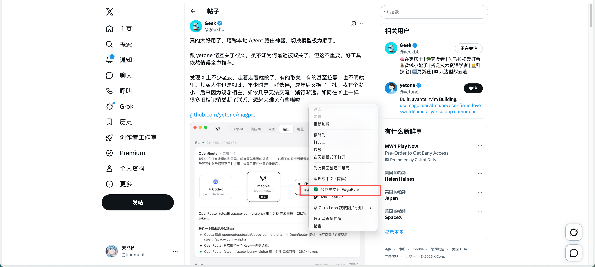 |  |

---

### 7. 知乎回答与文章剪藏

在知乎网页端阅读时，无需复制整页内容，在目标回答或文章处右键点击「保存回答/文章到 EdgeEver」。

- 自动解析问题标题、回答者、正文排版、发布时间与原始链接，生成清晰的问答结构笔记。

| 1. 右键保存回答/文章 | 2. 问答结构笔记预览 |
| :---: | :---: |
|  |  |

---

### 8. Reddit 讨论帖剪藏

浏览 Reddit 社区时，使用 EdgeEver Web Clipper 插件在帖子标题或正文处右键点击「保存所选内容到 EdgeEver」。

- 自动捕获帖子标题、所属版块（Subreddit，如 `r/AskReddit`）、发帖作者、时间戳及原始链接，保留社区讨论元数据。

| 1. 右键保存帖子 | 2. 包含社区元数据的笔记预览 |
| :---: | :---: |
| 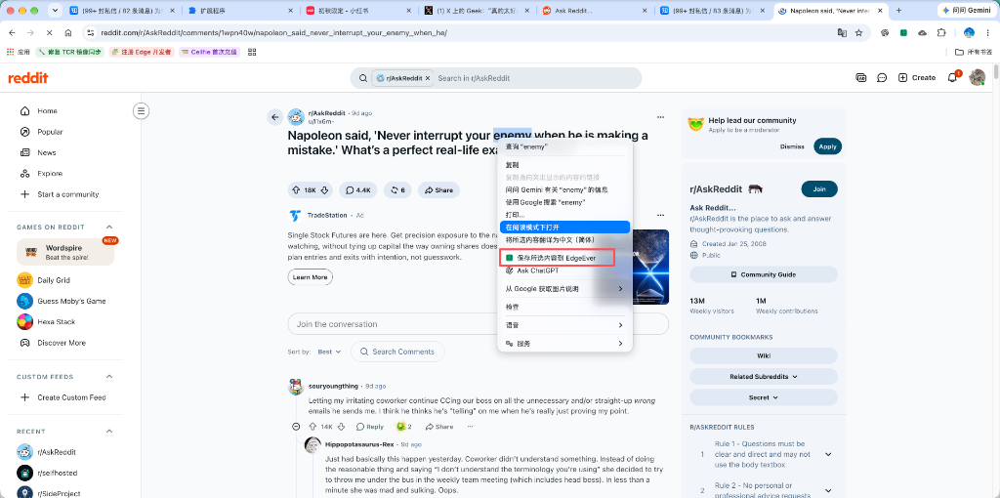 | 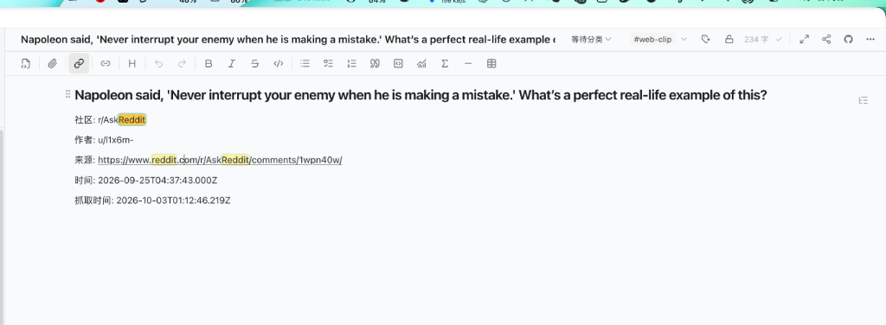 |

---

### 9. GitHub 仓库元数据剪藏

在浏览器访问 GitHub 仓库时，使用 EdgeEver Web Clipper 插件在页面任意位置右键点击「保存仓库信息到 EdgeEver」。

- 自动提取仓库名称（Owner/Repo）、简介（About）、官方主页、开发语言、开源许可证、话题标签（Topics）与链接，生成结构化技术卡片。

| 1. 右键保存仓库信息 | 2. 结构化仓库卡片预览 |
| :---: | :---: |
| 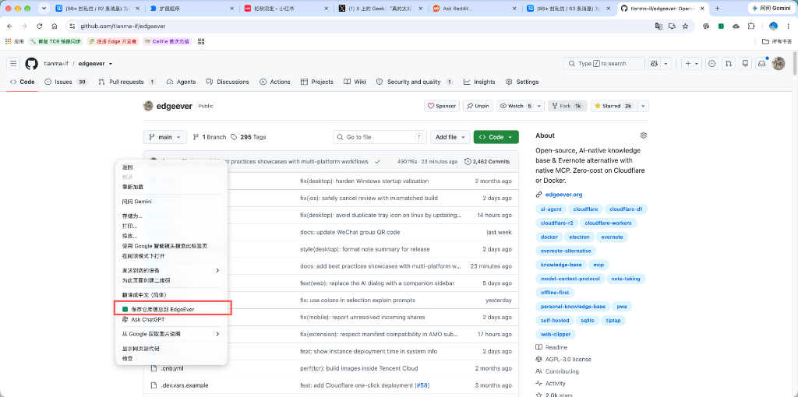 | 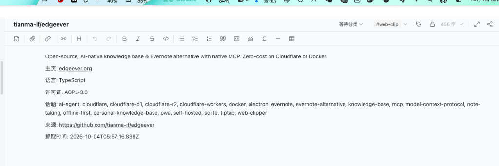 |

---

## AI 增强与多维数据组织

### 10. AI 对话生成思维导图、流程图与架构图

在右侧伴随式 AI 助手（或连接的本地 Agent）中输入自然语言指令（如“帮我生成一个关于 AI 大模型的思维导图 / 流程图 / 架构图”），即可原地创建可交互、可编辑的可视化图表。

- 依托 EdgeEver 原生图谱引擎，支持节点拖拽编辑、自动布局、流程条件分支与系统拓扑展示。
- 无需依赖外部绘图工具，图表直接保存在笔记中。

| 1. 交互式思维导图 | 2. 标准流程图 | 3. 系统架构图 |
| :---: | :---: | :---: |
| 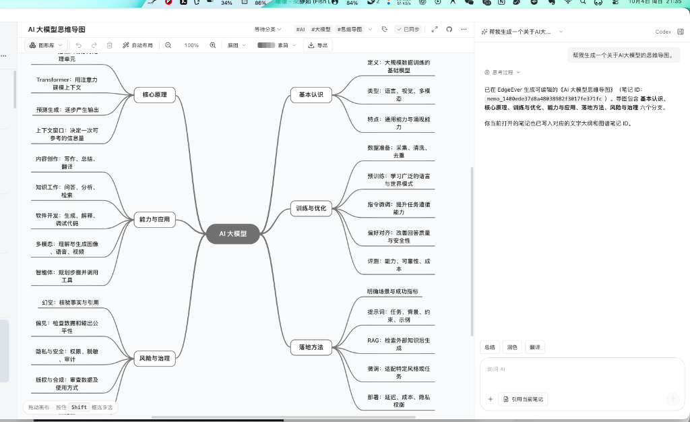 | 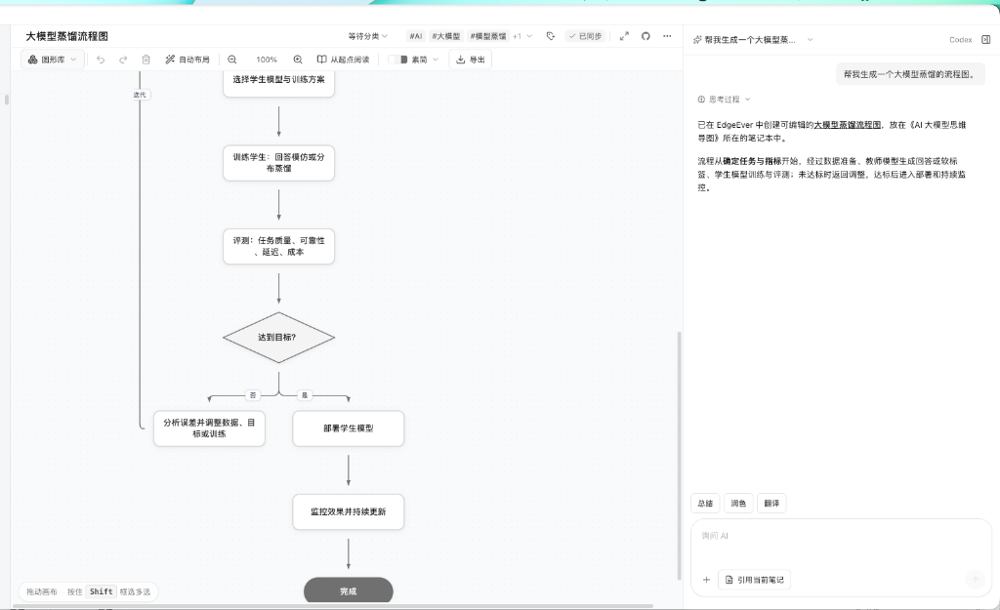 | 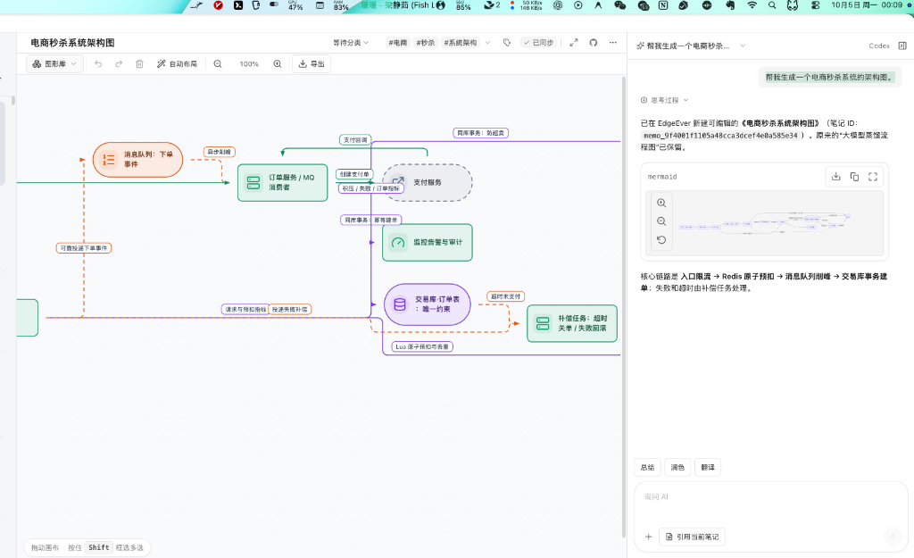 |

---

### 11. AI 生成结构化信息图（时间线、对比矩阵、象限图等）

利用内置的信息图模板库（涵盖时间线、对比矩阵、四象限、层级图等），在 AI 助手对话中描述要呈现的主题与重点。

- AI 自动梳理关键事实与时间节点，生成具备结构化排版的信息图笔记。
- 支持通过后续对话微调内容，或直接导出为矢量图。

| 1. 信息图模板库 | 2. 时间线信息图生成效果 |
| :---: | :---: |
| 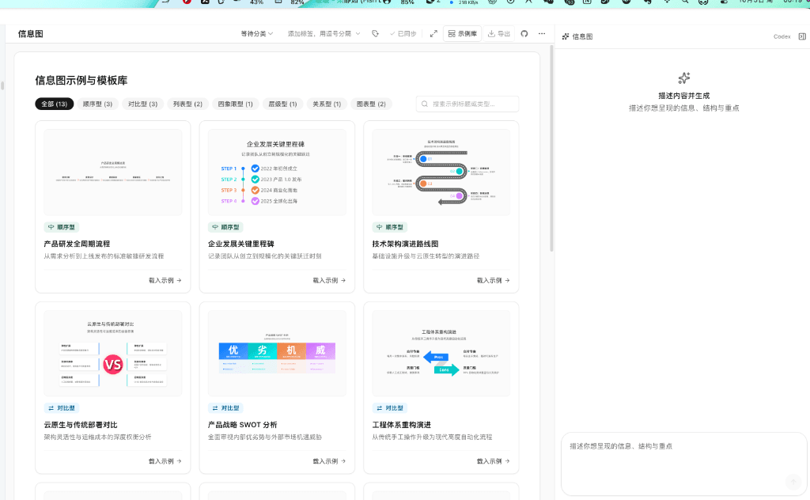 | 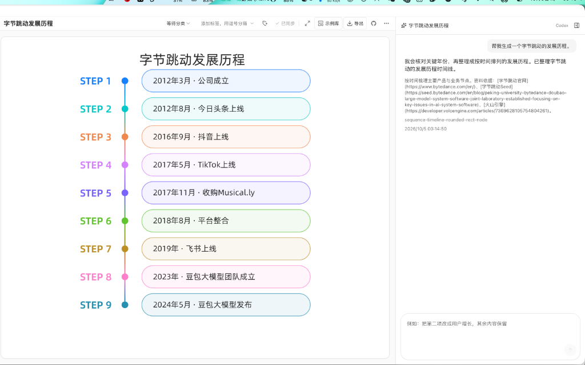 |

---

### 12. AI 对话构建多维表格

在右侧 AI 助手中发送指令（例如“帮我生成一个自媒体选题库的多维表格”或“帮我生成员工信息登记表”），AI 会自动根据业务场景搭建数据表。

- 自动配置单选标签、文本、日期、链接等多维字段类型。
- 自动填充初始示例数据，支持视图切换、筛选排序与 CSV 导出。

| 1. 选题库多维表格 | 2. 员工信息多维表格 |
| :---: | :---: |
| 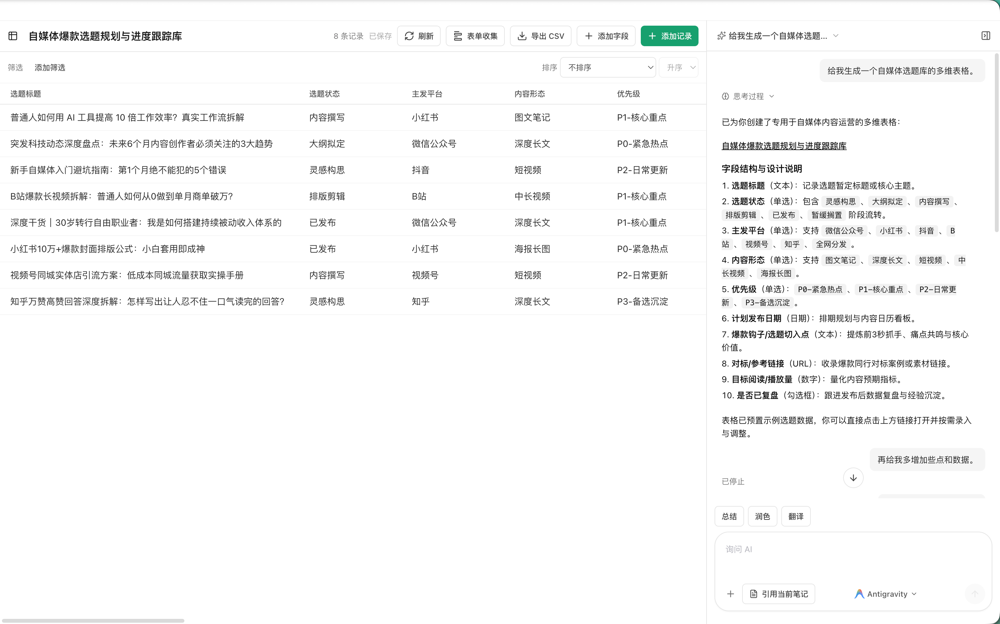 | 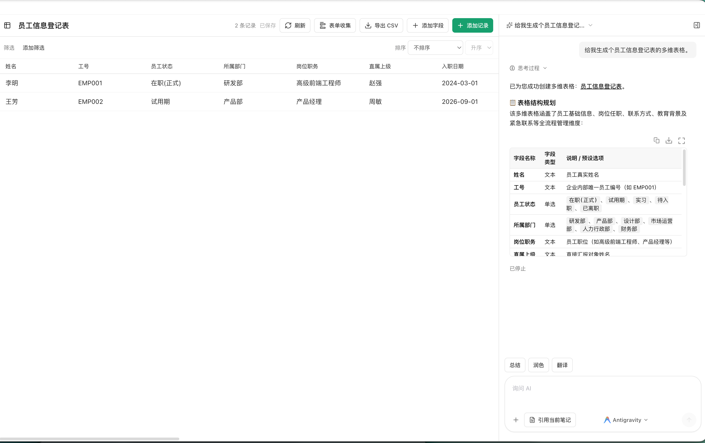 |

---

### 13. 多维表格生成公开收集表单

在多维表格顶部点击「表单收集」，可将当前数据表转为公开在线表单页面。

- 外部填写者无需登录即可通过浏览器提交信息。
- 表单字段与下拉选项和多维表格实时同步，提交的数据直接写入表格中。

| 1. 开启「表单收集」 | 2. 在线表单填报页面 |
| :---: | :---: |
|  |  |

---

### 14. 连接本机 Agent (ACP) 实现笔记协同

EdgeEver 支持 **ACP (Agent Client Protocol)** 协议，允许桌面端连接本机运行的各类 AI Agent（如 Codex、Claude Code、DeepSeek Harness、Antigravity 等）。

- **本地授权**：授予本地 Agent 当前账号笔记的安全读写权限。
- **伴随对话**：在笔记右侧栏直接与本地 Agent 交互，执行代码推理、长文总结与知识库检索。

| 1. 设置中心连接本地 Agent (ACP) | 2. 笔记侧边栏协同交互 |
| :---: | :---: |
|  | 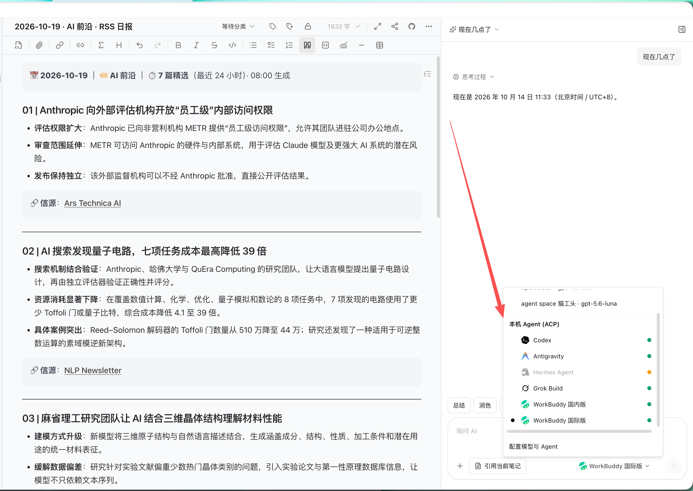 |

---

## 排版与多渠道分发

### 15. AI RSS 订阅日报与长图分享

内置的 AI RSS 订阅功能可自动聚合订阅源资讯，生成结构清晰的日报笔记。

- **多款样式导出**：配合「分享为图片」功能，提供 8 款卡片主题、字体与版式调整，支持导出长图或复制到剪贴板。
- **技术代码卡片**：提供专属「代码」主题，包含 macOS 窗口控件、行号与等宽代码排版。

| 1. 菜单选择「分享为图片」 | 2. 配置主题与排版 | 3. 导出长图预览 |
| :---: | :---: | :---: |
| 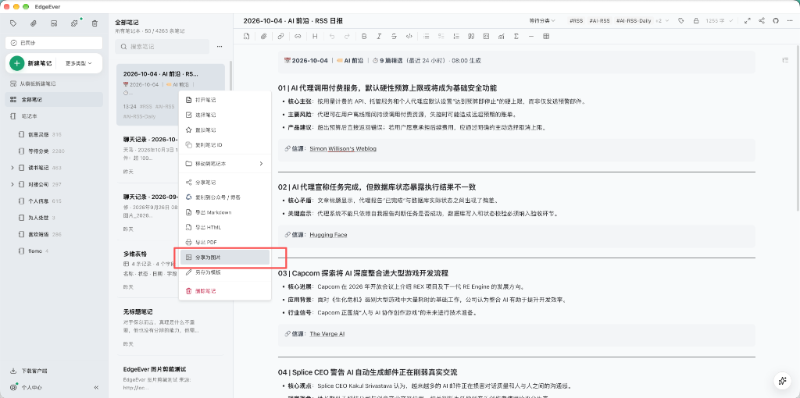 | 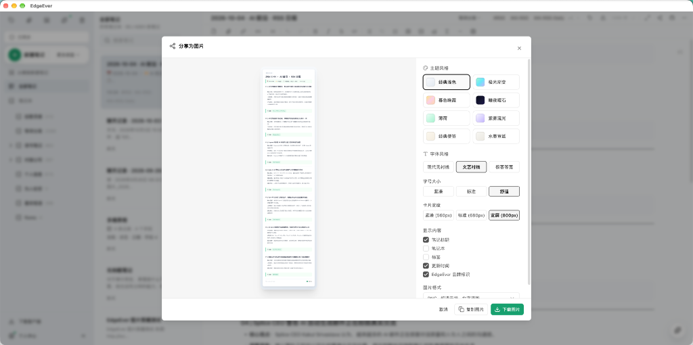 | 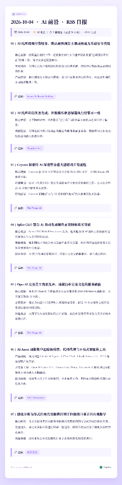 |

| 「代码」主题样式预览 |
| :---: |
| 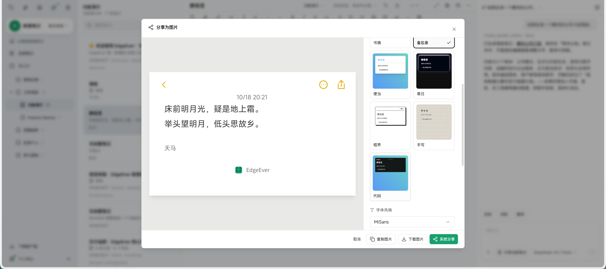 |

---

### 16. 笔记制作社交媒体海报与封面

在笔记操作菜单中选择「制作海报」（或通过「新建 → 海报」），可将笔记标题与要点导入海报设计工作台。

- 提供 40+ 款设计模板，支持小红书 3:4、朋友圈 1:1 及横版等画幅。
- 支持在画布中调整排版、配色与装饰元素，完成后可导出高分辨率图片。

| 海报设计工作台与模板库 |
| :---: |
|  |

---

### 17. 复制笔记至微信公众号排版

在笔记列表或菜单中选择「复制到公众号 / 博客」，可将整篇笔记转换为内联 CSS 样式的富文本。

- 粘贴至微信公众号后台编辑器后，保留表格、引用块、代码块、列表及字体样式。
- 无需依赖第三方微信排版工具。

| 1. 复制到公众号 / 博客 |
| :---: |
| 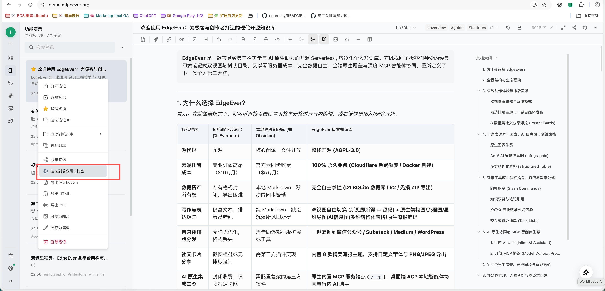 |

| 2. 公众号后台编辑器粘贴效果 |
| :---: |
|  |
