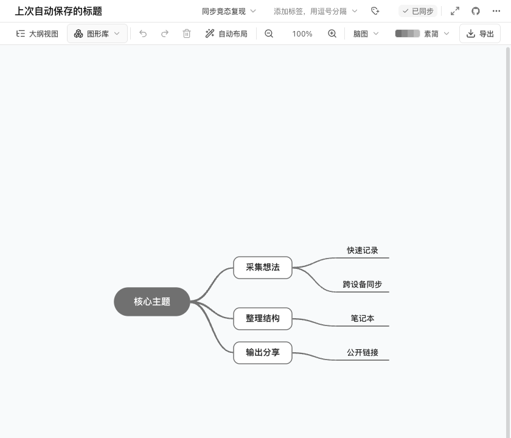
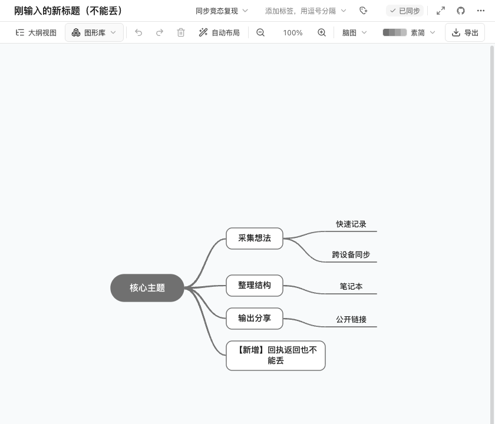
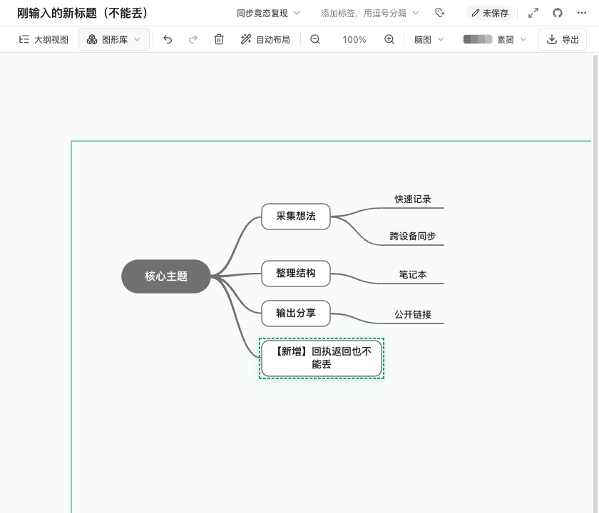
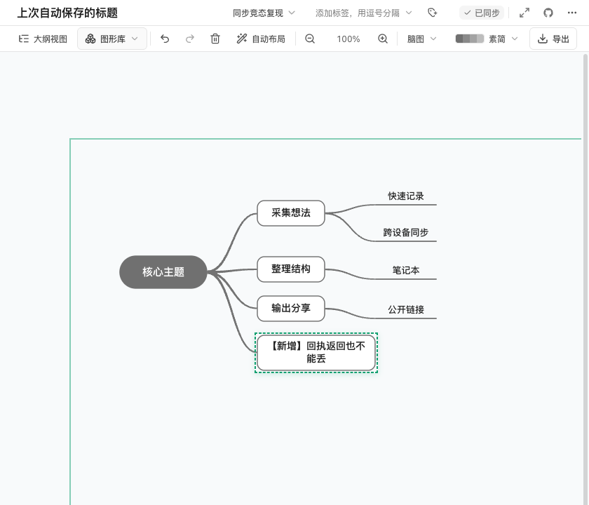
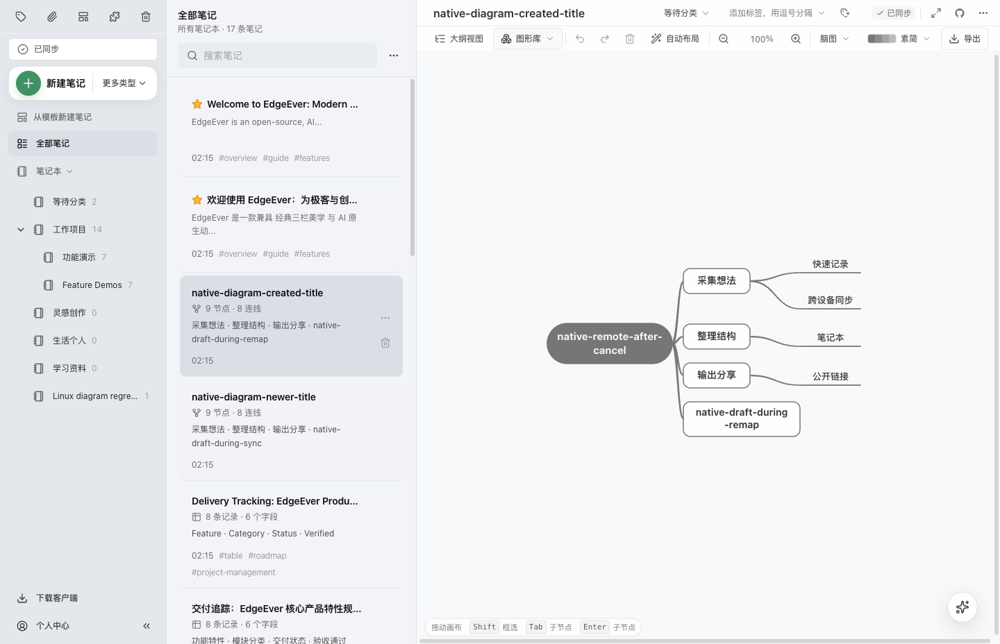
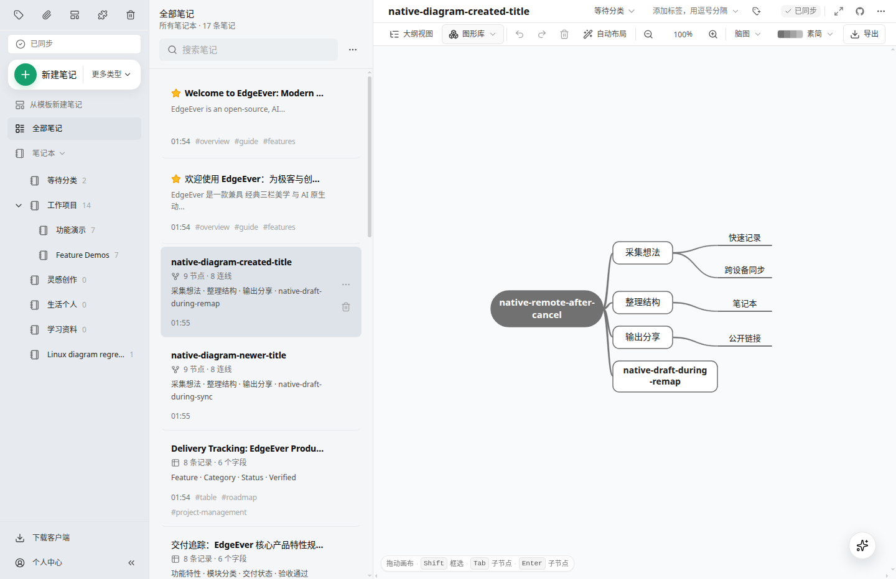

# Preserve diagram drafts during synchronization

## Problem and goal

[Issue #737](https://github.com/tianma-if/edgeever/issues/737) reports disappearing mind-map edits while the client displays a synchronized status. The shared diagram editor clears its dirty state when a memo revision changes and reloads the canvas when its content hash changes, including while newer local edits are unsaved. Preserve those edits and keep the save status accurate.

## Allowed changes and acceptance

- Reconcile incoming snapshots in the shared mind-map, flowchart, and architecture editor without replacing unsaved canvas, title, tags, inline node text, or outline edits. A sync acknowledgment for this device may advance the concurrency base, but must not discard a draft, cancel its autosave, or clear its undo history.
- Treat a new note's temporary-to-server ID remapping as the same editor session, retaining the canvas, focus, and unsaved input. If an incoming remote snapshot is deferred while input is active, apply it when that input is canceled or the draft returns to its saved baseline; do not rebase a genuinely changed draft onto remote content.
- Keep edits made while a local save is pending dirty until their own save completes. A completed save acknowledges only the memo, canvas, and snapshot it submitted, including when the user has started editing another node.
- Continue to apply genuine remote changes when the editor has no local draft. When a genuine remote change arrives during editing, preserve the draft and its original concurrency base so the existing synchronization conflict handling remains effective.
- Add a focused browser regression: delay a sync acknowledgment until a subsequent graph edit or inline edit exists, then verify the edit remains and reaches durable storage after autosave and reopening. Cover revision-only and content-hash updates, metadata, and an idle editor receiving a remote update with the same focused workflow or the existing isolated reproduction where needed. Make the regression fixtures independent of existing tags and selected notebooks; wait for API health through the Web proxy before initializing browser sessions.
- Run the affected diagram checks, `bun run typecheck`, `bun run typecheck:mobile`, and `bun run build:web`. Inspect the rendered editor and exercise its edit/save path. Record desktop-client coverage separately from browser checks.
- Capture a controlled before/after comparison on the PR's v2.16.0 baseline and fixed renderer through the same macOS native development entry: hold a real save response, make identical later node/title edits, then release the response. Show both versions immediately before and after the acknowledgment, and check the resulting local and server content after autosave.
- Preserve the queued structured `contentJson` in desktop `memo.create` requests, using the existing API field and resource-URL normalization. Keep Markdown-only queue entries supported, and verify that a pending creation written by the unmodified v2.15.0 native client uploads and remains editable after loading the fixed renderer on the same SQLite profile. Do not weaken the suspicious-overwrite protection. Verify that creating a diagram and then changing its title and nodes uploads successfully without counting serialized metadata as note text.
- Verify the macOS native client through the project's standard local-development entry, using its pinned Electron and a locally compiled Rust sidecar from v2.15.0 source. Verify the Linux native client under Xvfb with the formal v2.15.0 runtime. Both use a renderer built from that source with only this task's fixes applied. Use temporary application data, databases, and test services with auto-update disabled; do not replace an installed client or change an existing service.

## Unchanged boundaries

Keep the existing 1,200 ms autosave delay, input rules, save-failure behavior, repository entry points, synchronization protocol, conflict resolution, database schema, backups, and native platform implementations. Do not change the text, table, poster, or infographic editors, add dependencies, or publish a release. Existing unrelated note-import work is outside this change.

## Risk and rollback

Incorrect acknowledgment classification could hide a genuine remote change or advance a draft onto the wrong concurrency base. Verify self-sync and genuine remote updates separately. The desktop-create change affects the initial server content and its hash; a mismatched structured document could corrupt that initial representation. Verify queued structured content and legacy Markdown-only entries, then exercise the real native create/edit/sync/restart path on macOS and Linux. Revert the diagram-editor reconciliation changes and desktop-create field forwarding to roll back; no data migration is required.

## Completion check

- The product diff is limited to `DiagramEditorPane.tsx` and the desktop `memo.create` request in `desktop-sync.ts`. Snapshot reconciliation preserves local drafts and active input, advances self-sync bases separately, refreshes edit sessions without blocking autosave, and binds save responses to their originating logical memo and canvas. It reuses the existing editor-identity helper to retain the graph, outline, and focus across ID remapping. Deferred remote updates resume when input is canceled or the draft returns to its saved baseline; the actual outline and dirty states drive this decision rather than an aggregate dirty flag. A newly saved local draft retains its original concurrency base for conflict handling.
- The three Chrome scenarios in `tests/e2e/memo-sync-race.spec.ts` pass, including the existing text-caret regression. The diagram scenarios verify: delayed real API acknowledgments preserve node/title/tag edits and survive reopening; new-note ID remapping retains focus and the original graph before saving and reopening; idle remote updates apply, including after canceling unchanged node input or restoring an outline removal while tags have returned to their baseline. Remote changes during genuine editing preserve the draft's original revision/hash. Run `bunx playwright test tests/e2e/memo-sync-race.spec.ts --grep 'mind-map'` with a Playwright browser installed.
- Isolated browser checks held a local save open while editing the title and another node, and remapped a note with an invalid outline still being edited. Drafts, input focus, and the original graph were retained; the successor save used the acknowledged revision. Input and undo remained usable after self-sync. The rendered editor was inspected.
- All 67 diagram editor, snapshot, editor-identity, and desktop-sync checks pass, covering structured creation payloads and existing Markdown-only queue entries. `bun run typecheck`, `bun run typecheck:mobile`, and `bun run build:web` pass with both fixes.
- Linux packaged-runtime checks under Xvfb pass with the formal v2.15.0 Electron/sidecar and the patched renderer: delayed acknowledgments retain later node/title edits; temporary-ID remapping retains the graph and focused input; genuine remote changes apply while idle and after canceling unchanged input. Both diagrams, including a new diagram whose title and nodes changed during creation, are present in real sidecar SQLite and server storage and survive a full application restart.
- The desktop create request now forwards its normalized structured `contentJson`. Serialized diagram metadata is no longer counted as note text during creation, so the subsequent title/node edit is uploaded without weakening `suspicious_memo_overwrite` protection. A pending creation written through the unmodified v2.15.0 native client's sidecar is uploaded after switching the same SQLite profile to the fixed renderer, remains editable, and survives another full restart with no pending, failed, or conflicted queue items.
- The macOS native client passes the same four workflows through the standard local-development entry: delayed acknowledgments, focused input across ID remapping, genuine remote updates, and persistence after a full restart. It uses Electron 44.7.0, a locally compiled Rust sidecar, real SQLite, and the real test API from v2.15.0 source. This covers native functionality; signed-installer and updater validation remains with the release workflow. Windows native validation remains unperformed.

## Controlled macOS native comparison

The unmodified v2.16.0 baseline (`01422910`) and fixed renderer (`e0e1b678`) use the same standard native development entry, Electron 44.7.0, Rust sidecar, real SQLite, and real API. Both use a 1440 × 900 window; screenshots crop the same editor area at 100% zoom.

1. Open an eight-node mind map and change its title to “上次自动保存的标题”. Let the real API store that autosave, but hold its response.
2. Before the next 1,200 ms autosave, add “【新增】回执返回也不能丢” and change the title to “刚输入的新标题（不能丢）”. Pause the renderer clock to keep this draft pending, then release the older response.
3. Advance the clock by 1,400 ms, synchronize, read the native SQLite memo and server memo, then fully quit and restart the native client and reopen the note. The API response and memo data are not rewritten by the test.

| Stage | Before the fix | After the fix |
| --- | --- | --- |
| Older response still held | New title, 9 nodes, unsaved | New title, 9 nodes, unsaved |
| Older response delivered | Title reverts; 9 nodes remain visible, but status incorrectly says synchronized | New title and 9 nodes remain; status correctly stays unsaved |
| Autosave and reopen | Local/server storage never received the new node; only 8 nodes and the old title reopen | Local/server storage contains the new node and title; all 9 nodes reopen synchronized |

The disappearing node in this reproduction occurs on reopening, not immediately on acknowledgment: the incorrect clean state cancels the pending autosave. [Recorded native and API observations](evidence/2026-10-31-diagram-sync-drafts/macos-controlled-comparison.json).

### The visible difference after restart

**Before the fix: the new node disappears, the count drops from 9 to 8, and the title reverts.**

**After the fix: the new node and title remain, with all 9 nodes after restart.**

Show the four screenshots before and after the older acknowledgment

#### Response held: both versions have the same new, unsaved draft

Before the fix:

After the fix:

#### Response delivered: the baseline reverts the title and falsely reports synchronized; the fix retains the unsaved draft

Before the fix:

After the fix:

## Additional native restart screenshots (v2.15.0)

macOS, through the standard native development entry: the renamed diagram, added node, and remote update remain after a full application restart.

Linux, with the formal v2.15.0 runtime and patched renderer under Xvfb: the same changes remain after restart and the client reports synchronized.

